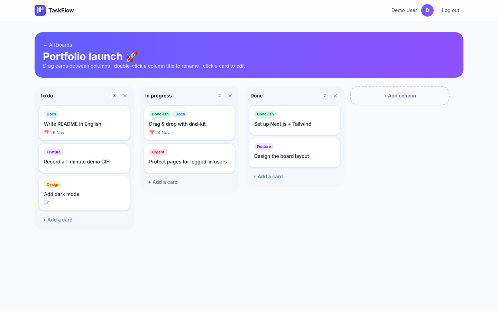
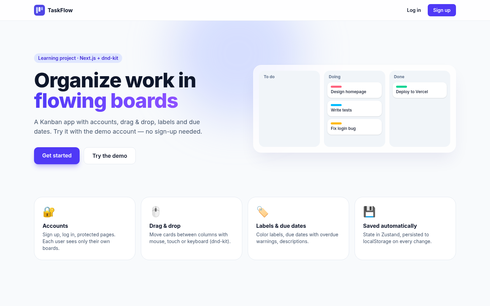
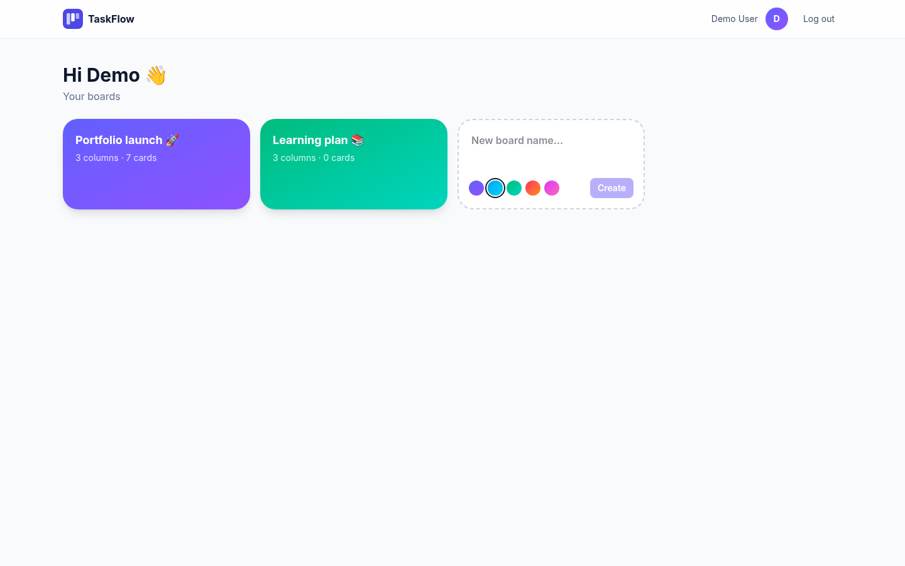
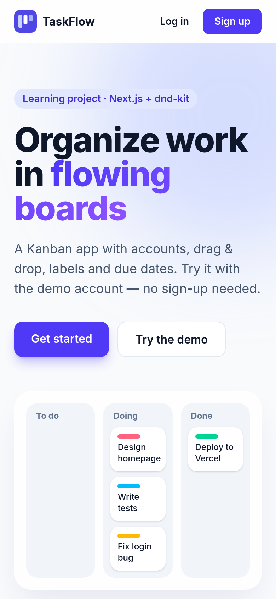

# TaskFlow — Kanban boards with auth & drag-and-drop

A Trello-style task manager built with **Next.js 15 (App Router, static export)**, **TypeScript**, **Zustand** and **dnd-kit**, with smooth **Motion** animations.
Learning project #5 from my React / Next.js / Node portfolio plan.

**Live demo:** https://davidgeorgeconstantin-spec.github.io/taskflow/
Demo account: `demo@taskflow.dev` / `demo1234` (or use the "Try the demo account" button).



## Features
- Sign up / log in / log out, protected pages (`RequireAuth`), each user sees only their boards
- Multiple boards with color themes, create / rename / delete
- Columns: add, rename (double-click), delete
- Cards: drag & drop between and inside columns (mouse, touch **and keyboard**), labels, due dates with overdue warning, description
- Everything persisted in `localStorage` through Zustand `persist`
- Animations: auto-playing board preview with shared `layoutId`, staggered lists, layout animations when cards move, rotated drag overlay, animated modal, `prefers-reduced-motion` respected
- Production path documented: Supabase schema with Row Level Security in [`supabase/`](supabase/README.md)

> **Note on auth:** the live demo runs only in the browser. Passwords are hashed with SHA-256 + salt (Web Crypto) and stored in localStorage — good for learning the flow, **not production-secure**. See `supabase/README.md` for the real setup.

## Stack
Next.js 15 · React 19 · TypeScript (strict) · Tailwind CSS 4 · Zustand 5 · dnd-kit · Motion 12 · ESLint 9 · GitHub Actions + GitHub Pages

## Project structure
```
src/
├─ app/                    # routes (App Router)
│  ├─ page.tsx             # landing
│  ├─ login/ signup/       # auth pages
│  └─ app/ app/board/      # protected: boards list, board (?id=)
├─ components/
│  ├─ layout/              # AppHeader, Providers
│  └─ ui/                  # Button, Modal
├─ features/
│  ├─ auth/                # authService, AuthProvider, RequireAuth, AuthForm
│  ├─ boards/              # boardStore (Zustand), BoardsList
│  ├─ kanban/              # KanbanBoard, KanbanColumn, SortableCard, TaskCard, CardDialog
│  └─ landing/             # BoardPreview animation
├─ lib/                    # id, cn, paths
└─ types/                  # shared types
supabase/                  # schema.sql + RLS policies (production path)
```

## Run locally
```bash
npm install
npm run dev      # http://localhost:3000/taskflow
npm run build    # static export to /out
```

## Deploy
Push to `main` → `.github/workflows/deploy.yml` lints, builds and publishes `out/` to GitHub Pages
(Settings → Pages → Source: **GitHub Actions**).

## Screenshots
| Landing | Boards | Mobile |
|---|---|---|
|  |  |  |
